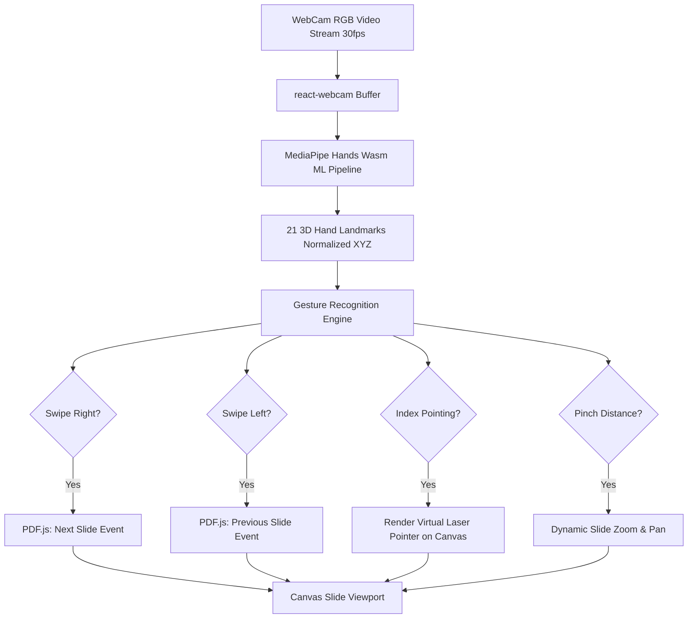

# Full Project Analysis: Gesture PDF Presenter

## 0.1 What the Project Is
**Gesture PDF Presenter** is an open-source, touchless presentation control system that transforms standard webcams into interactive gesture sensors.

Engineered for lecturers, keynote speakers, and conference presenters, it eliminates the need for handheld physical clickers or running back and forth to a laptop. Presenters simply face their audience and use natural hand gestures in mid-air to advance slides, return to previous sections, point virtual laser beams, and draw digital annotations directly over live PDF documents.

## 0.2 Real-Time Gesture Processing Loop Diagram

## 0.3 Inventory Counts
- **Total Frontend Views**: 1 interactive presentation console with HUD overlay and gesture guidance drawer.
- **Backend Endpoints**: 4 REST endpoints (`/api/upload`, `/api/presentations`, `/api/health`).
- **Computer Vision Landmarks**: 21 continuous 3D coordinate pairs tracked per frame.
- **Supported Gestures**: 6 distinct gestures (Next, Previous, Laser Point, Draw, Zoom, Clear).
