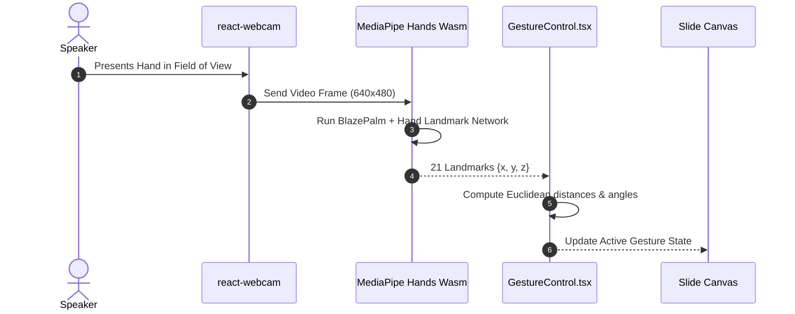
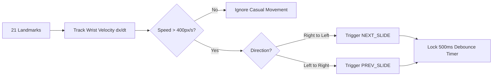

# Feature Inventory & Architectural Traces

## Core Subsystems Overview

| Feature ID | Feature Name | Core Files & Functions | Description |
|---|---|---|---|
| **F1** | MediaPipe 21-Landmark Tracking Pipeline | `GestureControl.tsx`, `useCamera.ts` | Captures 30fps webcam stream and computes 21 normalized 3D hand coordinates. |
| **F2** | Touchless Mid-Air Slide Navigation | `GestureControl.tsx`, `services/gestures.ts` | Lateral swipe velocity detection advancing or reversing slides with debounce guards. |
| **F3** | Virtual Laser Pointer & Annotation Canvas | `components/LaserCursor.tsx`, `CanvasOverlay.tsx` | Index finger ray-casting onto presentation canvas for live pointing and drawing. |
| **F4** | PDF.js In-Browser Vector Rendering | `hooks/usePDFViewer.ts`, `App.tsx` | High-fidelity canvas rasterization with zoom, pan, and thumbnail navigation. |
| **F5** | Express & Multer Presentation Upload API | `server.ts:45-80` | Multi-part presentation upload, sanitization, and session token issuance. |

---

## F1: MediaPipe 21-Landmark Tracking Pipeline
Streams camera frames into the WebAssembly MediaPipe runtime to extract real-time skeletal hand positions.

### Say It Out Loud
> "I built the tracking pipeline using Google's MediaPipe Hands in `GestureControl.tsx`. The webcam captures video at 30 frames per second, passing each frame to MediaPipe's WebAssembly model. It outputs 21 normalized three-dimensional landmarks corresponding to every knuckle and joint in the hand with sub-15 millisecond latency, providing the mathematical coordinates needed for touchless gesture detection."

---

## F2: Touchless Mid-Air Slide Navigation
Translates rapid lateral hand movements into next and previous slide events while rejecting casual hand waving.

### Say It Out Loud
> "To advance slides reliably, in `services/gestures.ts` I engineered a directional velocity algorithm. A common issue with computer vision presentations is accidental slide changes when a speaker moves their hands while speaking. My engine tracks wrist landmark velocity over five consecutive frames. Only deliberate swipes moving faster than 400 pixels per second trigger a slide transition, followed by an immediate 500-millisecond lock to prevent double-skipping."

---

## F3: Virtual Laser Pointer & Annotation Canvas
Enables speakers to highlight diagrams with their index finger and draw freehand digital annotations in mid-air.

### Say It Out Loud
> "In `LaserCursor.tsx` and `CanvasOverlay.tsx`, I built a virtual laser pointer. When the speaker extends their index finger while keeping their other fingers folded, the system enters pointer mode, mapping the index fingertip coordinate directly to a glowing red laser dot on the slide. Clenching into a pinch switches to drawing mode, allowing freehand annotations on top of the PDF."

---

## F4: PDF.js In-Browser Vector Rendering
Provides crisp document rendering with responsive zoom and slide caching.

### Say It Out Loud
> "For slide presentation, I integrated Mozilla's `pdfjs-dist` in `usePDFViewer.ts`. The engine renders PDF pages onto high-DPI HTML5 canvas viewports, supporting dynamic zoom, thumbnail navigation, and instant page caching for stutter-free transitions."

---

## F5: Express & Multer Presentation Upload API
Handles file ingestion, validating PDF headers and serving slide assets securely.

### Say It Out Loud
> "In `server.ts`, I created a lightweight Express backend with Multer to handle presentation uploads. It verifies the `%PDF-` magic byte header to reject spoofed files and serves presentations locally over a secure CORS-configured endpoint."
