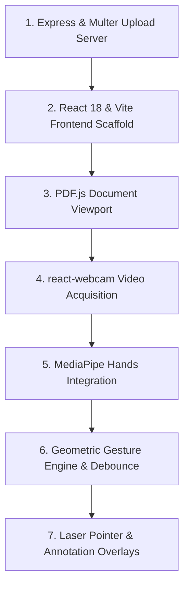

# Build Order: Reconstructing Gesture PDF Presenter

## Step-by-Step Implementation Flow

1. **Upload Server**: Implement `server.ts` with Multer file storage and PDF magic-byte checks.
2. **Frontend Setup**: Initialize Vite + React 18 with Tailwind CSS and Lucide icons.
3. **PDF Viewer**: Build `usePDFViewer.ts` integrating `pdfjs-dist` on an HTML5 canvas.
4. **Camera Stream**: Connect `react-webcam` with mirror transformation and 30fps capture.
5. **MediaPipe Tracking**: Initialize `@mediapipe/hands` WebAssembly worker.
6. **Gesture Recognition**: Develop Euclidean vector heuristics and temporal debounce locks.
7. **Overlay Canvases**: Implement `LaserCursor.tsx` and drawing tools.
