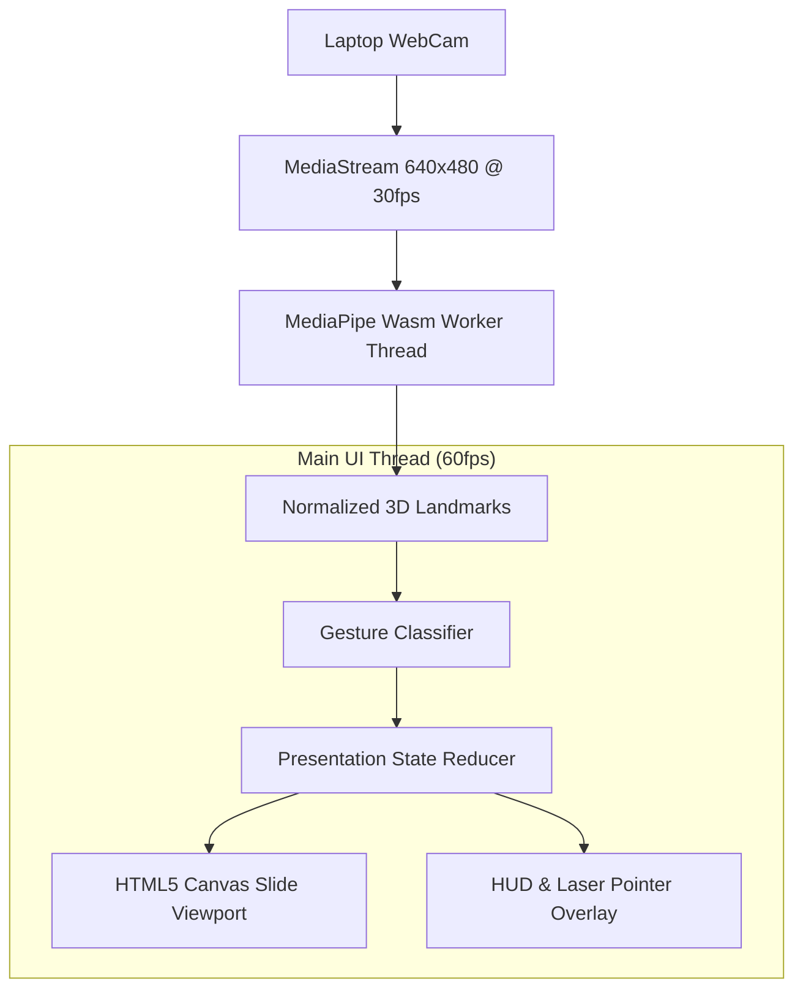

# Architecture & Real-Time Computer Vision Loop

## High-Level Architecture

## Threading Architecture
The MediaPipe vision pipeline runs asynchronously in WebAssembly threads, preventing heavy computer vision calculations from blocking smooth 60fps slide animations on the main JavaScript thread.
